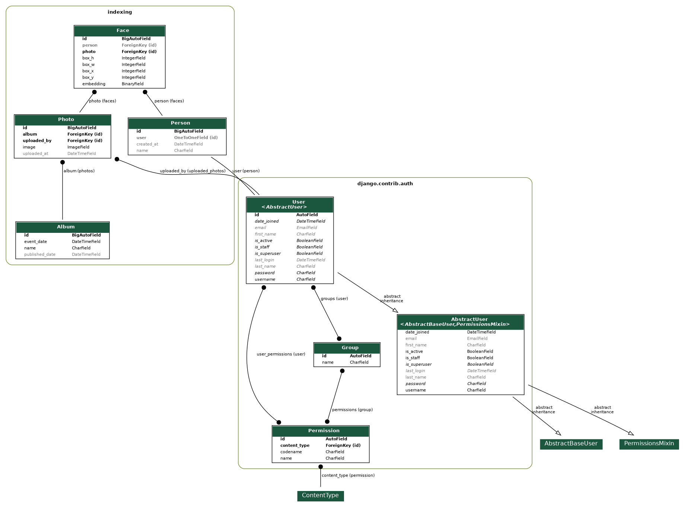

# INTêtes

Application web permettant aux étudiants de retrouver les photos d'un album où ils apparaissent, en déposant une photo de leur visage. Projet du module **PRO 8501** (projet informatique en Python, FISA 2A, Télécom SudParis).

- Cahier des charges v2.1 : [`docs/Cahier des charges v2 - INTêtes.pdf`](docs/Cahier%20des%20charges%20v2%20-%20INTêtes.pdf)
- Carnets de labo : [`docs/carnets-de-labo/`](docs/carnets-de-labo/)

---

## Lancement rapide (Docker)

```bash
git clone https://github.com/eldertek/TSP_2AFISA_8466.git
cd TSP_2AFISA_8466
./run.sh
```

*(Équivalent à `docker compose up -d --build`.)*

Une fois les conteneurs démarrés (`healthy`), l'application est accessible sur :

- **Site web** : http://localhost:8080
- **Compte administrateur créé automatiquement au démarrage** :
  - Identifiant : **`admin`**
  - Mot de passe : **`projetinfo1A`**

### Routes principales

| URL | Accès | Rôle |
|---|---|---|
| `/` | Connecté | Dépôt d'une photo de soi et affichage des résultats par similarité |
| `/indexing/` | Staff (`is_staff`) | Création/sélection d'un album et upload multi-photos vers Celery |
| `/admin/` | Staff | Interface d'administration Django (`Album`, `Photo`, `Person`, `Face`, `User`) |
| `/accounts/login/` | Public | Connexion |
| `/register/` | Public | Inscription réservée aux adresses `@telecom-sudparis.eu` et `@imt-bs.eu` |
| `/remove/` | Connecté (`POST`) | Retrait en un clic de ses empreintes biométriques de l'index (F7) |

---

## Architecture & Modèles de données

La stack orchestrée par [`compose.yaml`](compose.yaml) repose sur **6 services Docker** :

- **`nginx`** (`nginx:alpine`) : reverse proxy exposé sur le port `8080`, sert directement `/static/` et `/media/` via des volumes partagés.
- **`web`** (Django + Gunicorn) : serveur applicatif web, applique les migrations, collecte les statiques et initialise le compte `admin` au démarrage via [`entrypoint.sh`](entrypoint.sh).
- **`db`** (`postgres:17-alpine`) : base de données PostgreSQL avec healthcheck et volume persistant `postgres_data`.
- **`redis`** (`redis:7-alpine`) : broker et backend de résultats Celery.
- **`worker_indexing`** (Celery `-Q indexing`) : traite en arrière-plan la détection des visages (**YuNet**) et l'extraction des empreintes biométriques (**SFace**, 128 flottants `float32` stockés en 512 octets).
- **`worker_search`** (Celery `-Q search`) : file prioritaire dédiée aux recherches par similarité cosinus (seuil OpenCV `0.363`), pour qu'une recherche ne soit pas bloquée par l'indexation d'un album.

### Graphe des modèles



*(Généré avec `django-extensions` : `python manage.py graph_models indexing auth -g -o docs/models.dot` puis `dot -Tpng docs/models.dot -o docs/models.png`.)*

---

## Roadmap

### Fait
- **T3** : Détection des visages (OpenCV YuNet) et extraction d'empreintes (OpenCV SFace) dans `indexing/faces.py`.
- **T4** : Moteur de recherche par similarité cosinus (`search/service.py`) avec `select_related` pour éviter les requêtes N+1.
- **T7** : Modèles relationnels (`Album`, `Photo`, `Person`, `Face`), migrations dans Git et enregistrement dans l'admin Django.
- **T8** : Inscription et connexion réservées aux adresses académiques (`@telecom-sudparis.eu`, `@imt-bs.eu`).
- **T15** : Architecture asynchrone Redis + Celery avec deux files dédiées (`indexing` et `search`).
- **F1** : Page `/indexing/` réservée au staff permettant de créer/choisir un album et d'uploader plusieurs photos d'un coup.
- **T10 (backend)** : Rattachement des visages trouvés à `Person` et route `/remove/` supprimant les empreintes en cascade sans toucher aux photos.
- **Docker & CI/CD** : `Dockerfile`, `compose.yaml` (PostgreSQL, Nginx, Gunicorn, healthchecks), `run.sh`, 9 tests automatisés et pipeline GitHub Actions (`.github/workflows/ci.yml`).

### En cours
- **T5** : Affichage des vraies images (``) et lien vers la photo d'origine dans la galerie, libellé « Sans album » et internationalisation (i18n).
- **T10 (front)** : Ajout et stylisation du bouton de retrait dans `search/templates/search/home.html`.
- **T12** : Intégration finale de bout en bout.

### À faire / Optionnel
- Pages d'erreur personnalisées `404` et `500`.
- **T6** *(optionnel)* : Regroupement automatique des visages en personnes anonymes (F3).
- **T11** *(optionnel)* : Notifications en temps réel lors de nouveaux albums (F8, Channels/WebSockets).
- **F10** *(optionnel)* : Téléchargement de la sélection en une archive ZIP.
- **T13 & T14** : Recette avec le client, vérifications finales sur clone neuf et slides de soutenance.
- **T9** *(selon temps disponible)* : Déploiement sur le serveur MiNET et sauvegarde.

---

## Développement local, Tests & Qualité

### Installation hors Docker

```bash
python -m venv .venv
source .venv/bin/activate        # sous Windows : .venv\Scripts\activate
pip install -r requirements.txt
```

### Lancer les tests

```bash
python manage.py test
```

Les tests (détection YuNet, empreintes SFace, contrôle d'accès 302/403/200 sur `/indexing/`, upload multi-photos avec mock Celery, validation des mails académiques, recherche par similarité et retrait en un clic) s'appuient sur les photos NASA du domaine public dans `tests/donnees/` (sources dans [`tests/donnees/SOURCES.md`](tests/donnees/SOURCES.md)).

### Formatage et CI/CD

Le code est formaté avec **black** et **isort** (configuration dans [`pyproject.toml`](pyproject.toml) et [`.pre-commit-config.yaml`](.pre-commit-config.yaml)). Le workflow GitHub Actions ([`.github/workflows/ci.yml`](.github/workflows/ci.yml)) exécute automatiquement à chaque push et pull request :
- `isort --check` et `black --check` ;
- `python manage.py check` et `python manage.py makemigrations --check --dry-run` ;
- `python manage.py test` ;
- `docker build`.

---

## Données personnelles (RGPD)

Une empreinte faciale est une donnée biométrique sensible (article 9 du RGPD). Aucune photo d'étudiant réelle n'est versionnée dans ce dépôt (seules des photos du domaine public de la NASA sont utilisées pour les tests). Tout utilisateur peut supprimer ses empreintes biométriques de l'index en un clic via `/remove/` sans altérer les photos originales des albums.
